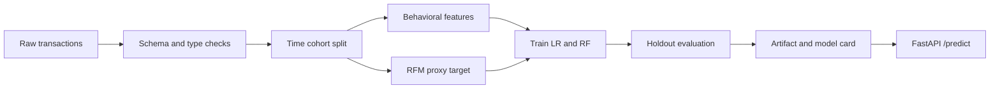

# Credit risk score from Xente transactions

A proxy credit score for Bati Bank, built from Xente eCommerce behavior. The file has no loan and no default flag. The label is a segment of engagement, not a repayment outcome. The served model is a random forest over mix and timing features. It does not see the recency, frequency, or monetary inputs that define the segment.

This is not a probability of default, and it is not a reason to decline credit.

## Result

Trained on the public Xente Fraud Detection Challenge training file: 95,662 transactions, 3,742 customers, 15 November 2018 through 13 February 2019. Customers are ordered by their first transaction. The latest 20% are the test cohort (from 23 January 2019), the 20% before that are validation, and the rest fit the segmenter and the grid. Customers with fewer than 3 transactions in their window are not scored. The test cohort has 560 scored customers, 122 of them in the high-risk segment.

The champion was chosen on validation ROC-AUC before the test numbers were used. A random forest (`max_depth=12`, `min_samples_leaf=5`) beat logistic regression by more than the 0.01 tie margin, so it is the model the API serves. Full precision is in [`reports/metrics.json`](reports/metrics.json). The table is rounded to 3 decimals.

| Model | ROC-AUC | PR-AUC | KS | Brier |
| --- | ---: | ---: | ---: | ---: |
| Constant score | 0.500 | 0.218 | 0.000 | 0.170 |
| Logistic regression | 0.652 | 0.479 | 0.308 | 0.218 |
| Random forest (served) | 0.785 | 0.581 | 0.433 | 0.146 |
| RFM oracle, not served | 0.9996 | 0.999 | 0.998 | 0.014 |

The oracle is a forest trained on the three label inputs. Its AUC is what the old pipeline was measuring: the ability to repeat KMeans. It is not a candidate.

At a cutoff of 0.30, chosen on validation to minimize `1 * false positives + 5 * false negatives`, the forest has precision 0.364 and recall 0.713 (87 true positives, 152 false positives, 35 false negatives). Under those assumed costs the test cost is 327, against 610 for calling everyone low risk and 438 for calling everyone high risk. The 1 and the 5 are placeholders, not a loss study. `class_weight="balanced"` pushes scores off the observed frequencies. Logistic regression's Brier score (0.218) is worse than the constant score (0.170). Use the score to rank, then apply the cutoff. Do not read 0.30 as a 30% chance of default.

Validation ROC-AUC for the forest was 0.831. The test figure is 0.785. That gap is the optimism left after a small grid.

## Architecture



The label is a KMeans cluster of three standardized columns: recency as a fraction of the customer's observed window, and `log1p` of frequency and monetary value per day of tenure. The high-risk cluster is the scaled center with the largest `z_recency - z_frequency - z_monetary`. The segmenter is fit on the fit cohort only and then frozen. Absolute days are not used, because a later cohort's whole life can be shorter than the fit cohort's quiet period, and that cohort would be unable to look "high recency." Raw totals are not used, because UGX amounts would otherwise dominate the sum.

The model sees mix and shape only: debit share, local night and weekend share (UTC+3), hour dispersion, gap regularity, entropy of the product and channel mix, ticket-size dispersion, and shares of category, channel, provider, and pricing level. Unique-count divided by the transaction count was rejected. It rewrites frequency. `FraudResult` is not an input. It is a different event (193 of 95,662 rows, 0.20%), and country and currency are constants (256, UGX).

Why each step exists is written next to the code, and the design note is [`docs/DESIGN.md`](docs/DESIGN.md). The model card is [`reports/model_card.md`](reports/model_card.md).

## Run

The training file is the Xente Fraud Detection Challenge training extract (Zindi). Save it as `data/raw/data.csv`. It is gitignored. This repo does not redistribute it.

```bash
python -m pip install -r requirements.txt -r requirements-dev.txt
PYTHONPATH=src python -m credit_risk.train --config configs/config.yaml
PYTHONPATH=src uvicorn api.main:create_app --factory --host 0.0.0.0 --port 8000
```

The process exits if `models/credit_risk_model.joblib` is missing. It does not start an untrained model.

```bash
curl -s localhost:8000/health
curl -s localhost:8000/features
```

`POST /predict` takes `customer_id` and a `features` object whose keys are exactly the list from `/features`. Missing or extra names, and non-finite values, are HTTP 422.

```bash
docker compose up --build
ruff check src tests
pytest
```

The EDA notebook is [`notebooks/eda.ipynb`](notebooks/eda.ipynb). Each section states the question, the finding, and the decision it drove. Training itself is the script above, not the notebook.

## Layout

```
configs/config.yaml       seed, split, grid, costs, paths
docs/DESIGN.md            why the previous evaluation was circular
src/credit_risk/          validate, split, features, proxy, WOE, train
src/api/                  FastAPI app and pydantic schemas
tests/                    features, proxy, train smoke test, API
notebooks/eda.ipynb
reports/                  metrics, plots, model card
models/                   the served artifact
```

## Limitations

- The label is low engagement, not default. Quiet and thin files are the ones the segment flags, including customers who have not had long to look active.
- The forest's test ROC-AUC of 0.785 means mix and timing track that segment on later customers. The strongest column is the dispersion of the local hour. A day that spreads across more hours can look like engagement. That is not the transaction count, and it is also not a credit outcome.
- The history is about ninety days. Nothing here is a stability test across seasons.
- Fit, validation, and test prevalence of the segment are 0.210, 0.267, and 0.218. The definition transfers better than an absolute-day recency rule, and the windows are still unequal. Rates and the recency fraction reduce that. They do not remove it.
- K = 3 is a choice. The cost ratio is a placeholder. Weight of evidence is reported and is not used to drop columns.
- 962 of 3,742 customers have fewer than 3 transactions and are never scored.
