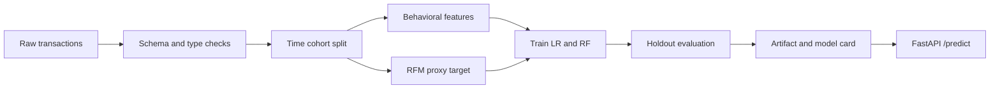

# Credit risk model, v1 design

This note is the contract for the v1 rewrite. It records what the current code actually does, why a reported AUC from that code would not be evidence of credit performance, and the pipeline that replaces it.

The business problem is unchanged. Bati Bank wants a credit score from Xente eCommerce behavior, because the file has no loan and no default flag. Basel-style use of a score still requires a label that is not a rewrite of the inputs, a split that respects time, and a report that says what the number does and does not mean.

## Current state

The repo trains a classifier on a customer table built from `data/raw/data.csv` (the public Xente training file: one row per transaction, columns `TransactionId` through `FraudResult`).

`src/data_processing.py` does three things:

1. Aggregate transactions to RFM: recency in days, frequency as the transaction count, monetary as `sum(Value)`.
2. Run `KMeans(n_clusters=3)` on scaled RFM and set `is_high_risk = 1` for the cluster with the largest `Recency - Frequency - Monetary`, computed from the **raw** cluster means.
3. Aggregate a wide customer feature matrix (amount and value sum/mean/std/min/max, time means, category dummies, `FraudResult` mean, `Transaction_Count`), scale it on the full sample, then weight-of-evidence encode it on the full sample.

`src/train.py` randomly splits that table 80/20, grid-searches logistic regression and a random forest on ROC-AUC, and always writes `models/random_forest_best.pkl`. Importing the module also executes training.

`src/api/main.py` loads that pickle. If the file is missing it **constructs an untrained `RandomForestClassifier` and serves it**. Errors come back as HTTP 200 with `is_high_risk: -1`. There is no health check. The request schema is a fixed list of the aggregate columns.

`tests/test_train.py` is empty. CI runs pytest and does not lint. The README names files that are not in the tree (`predict.py`, `pydantic_models.py`, `test_data_processing.py`, `notebooks/1.0-eda.ipynb`).

## Why the current evaluation is circular

The proxy label is a function of three numbers: recency, frequency, monetary. The feature matrix contains two of those numbers exactly, and a close cousin of the third.

| Label input | How it is defined | Column the model is given |
| --- | --- | --- |
| Frequency | count of transactions | `Transaction_Count` |
| Monetary | `sum(Value)` | `Value_sum` |
| Recency | days from snapshot to last transaction | not stored as its own column, but `Day`, `Month`, and `DayOfYear` aggregates move with it |

`Value_mean` is monetary divided by frequency. A tree, and even a linear model, can reconstruct the cluster assignment from those columns. ROC-AUC against `is_high_risk` then measures how faithfully the model repeats KMeans, not whether the score ranks credit risk. A random row split makes this worse: the same customer's neighbors, and the scaler, the WOE bins, and the cluster definition, were all fit with the test rows in the room.

Two quieter bugs push the same direction:

- The risk score uses **unscaled** cluster means. Monetary is in UGX and is orders of magnitude larger than recency (days) or frequency (a count), so "high risk" collapses to "lowest total spend."
- `ClusterTransformer.transform` recomputes which cluster is high risk from the batch in front of it. Scoring a book of good customers relabels the worst of that book as high risk. The label is not a frozen rule.
- `CustomWOE.transform` calls `qcut` again on the data being scored. The bin edges are not the ones stored at fit, so the WOE map often misses and is filled with 0.

So the current stack should not be quoted as a credit-model result, even if a future run prints a high AUC.

## Fix, and the caveat that remains

v1 keeps a proxy, because there is still no default flag. It changes what the model is allowed to see, and it freezes the rule that defines the label.

**Label.** On the training cohort only, build:

- `RecencyFraction`: days since the last transaction, divided by the length of that customer's observed window. Absolute days are not used. A later cohort's whole life can be shorter than the fit cohort's quiet period, so an absolute cutoff would make "high recency" a state the later cohort cannot reach.
- `LogFrequencyRate`: `log1p` of transaction count divided by tenure in days (tenure at least 1 day)
- `LogMonetaryRate`: `log1p` of `sum(Value)` divided by the same tenure

Rates, not totals, so a customer observed for three weeks is not automatically "low frequency" compared with a customer observed for two months. The log is there because monetary rate runs from tens of UGX per day to millions; a raw z-score spends its scale on a handful of merchants. Standardize those three columns, fit KMeans, and score each **scaled** center as `z_recency - z_frequency - z_monetary`. The high-risk cluster is the center with the largest score. That id is stored. Validation and test customers are labeled with the stored scaler, the stored KMeans, and the stored id. The definition is not recomputed on the batch.

**Features.** Composition and timing shape only: debit share, local-time night and weekend share, hour dispersion, gap regularity (`interval_cv`), entropy of the product, category, channel, and provider mix, ticket-size dispersion (`value_cv`), and share of category, channel, provider, and pricing level. The vocabulary of levels is learned on the fit cohort. Customers with fewer than 3 transactions in their window are not scored. The tenure is too short for the proxy to mean anything.

Entropy is used instead of unique-count divided by transactions. That ratio moves almost one-for-one with the inverse of the transaction count, which is the numerator of the frequency rate, so it would put the label back into the matrix. Entropy depends on the proportions only.

Explicitly excluded, because they are the label or a deterministic rewrite of it: recency, frequency, monetary, both rates, transaction count, value or amount sum and mean, tenure, mean inter-transaction gap, and `FraudResult`. `FraudResult` is a different event (193 of 95,662 transactions in the public training file, about 0.2 percent). It is not a default, and using it as an input would mix a rare fraud flag into a credit proxy. Country and currency are constants (256, UGX) and are dropped.

The training script refuses to fit if a denied column is in the matrix.

**What a metric means after this change.** ROC-AUC is the agreement between non-RFM behavior and an RFM-defined segment, on customers the segmenter did not see. It is not a probability of default, and it is not a Basel PD. A high number would mean the other behaviors track that segment. A number near 0.5 would mean the segment is mostly just RFM and the other behaviors do not carry it. Either result is reported as measured.

A second model, the RFM oracle, is fit on recency, frequency rate, and monetary rate alone and scored on the same test customers. It exists to show how high the AUC goes when the label inputs are available. It is written to the report as a diagnostic. It is never the served model.

## Target architecture



Steps, and why each one is there:

1. **Validate.** A wrong file should fail before any cluster is fit. Required columns, parseable timestamps, numeric amount and value, `FraudResult` in `{0, 1}`.
2. **Split by first-seen time.** Sort customers by first transaction. The last 20 percent are test, the 20 percent before that are validation, the rest are fit. Fit features use only transactions before the validation cohort starts. Validation features use only transactions before the test cohort starts. Test customers have no earlier transactions by construction. Scaler, KMeans, level vocabulary, and WOE edges see the fit cohort only. Hyperparameters and the cost threshold are chosen on validation. The test cohort is scored once.
3. **Features and proxy** as above. They meet at the customer id.
4. **Train** logistic regression on weight-of-evidence features, and a random forest on the raw features. Both are seeded and read from `configs/config.yaml`. WOE bin edges are stored on the transformer. Information value is reported and is not used to drop columns: selecting on the same rows that are fit would add another optimistic bias, and the column set is already small.
5. **Evaluate** on the test cohort. See the next section.
6. **Artifact.** One joblib bundle: the fitted pipeline, the feature columns, the threshold, the model name, a version, the seed. The API loads that bundle and nothing else.
7. **API.** If the file is missing or incomplete, the process raises and does not listen. There is no default estimator.

## Evaluation plan

Reported on the time-held-out customers, for the champion and for the model that was not selected:

| Measure | Why it is in the report |
| --- | --- |
| Constant-score baseline | ROC-AUC is 0.5 by construction. PR-AUC falls out at the test prevalence. This is the dumb answer. |
| ROC-AUC | Ranking quality, comparable across cutoffs. |
| PR-AUC | The positive class is one cluster of three, not a rare default. PR-AUC still shows whether precision survives as recall rises. |
| KS | The maximum gap between the score CDFs of the two proxy classes. A single number a credit committee expects to see, with the same caveat as the AUC. |
| Brier score and a reliability curve | `class_weight="balanced"` moves scores away from frequencies. The curve shows that, instead of hiding it. Scores are used to rank and to apply a cutoff. They are not quoted as probabilities of default. |
| Threshold and cost | Sweep the cutoff on the validation cohort. Cost = `1 * false positives + 5 * false negatives`. The 1 and the 5 are assumptions, not a loss study. The report also gives the cost of "call everyone low risk" and "call everyone high risk" on the test cohort. |
| Permutation importance | Shuffle each column on the test cohort and measure the drop in ROC-AUC. This is the explainability view in v1. It is descriptive. It is not used to choose features. SHAP is not a dependency; permutation importance answers the same question for this model size. |
| RFM oracle | Same test customers, features restricted to the three label inputs. Reported beside the champion so a high champion AUC cannot be confused with a leaked one. |

Model choice happens **before** the test numbers are used. Among the validation grid, logistic regression wins a tie within 0.01 ROC-AUC, because a linear WOE model is the one a reviewer can read. Otherwise the better validation ROC-AUC is served. The chosen specification is refit on fit+validation. The threshold stays the one chosen on the validation scores of the pre-refit model.

The seed, the grid, the split fractions, the costs, and the paths live in `configs/config.yaml`.

Plots and tables go to `reports/`: `metrics.json`, `evaluation.md`, `model_card.md`, and the figures. Numbers in the README are copied from that run. If a cohort has a single class, training raises. It does not invent a metric.

## Data plan

**Source.** `data/raw/data.csv` is the Xente Fraud Detection Challenge training file published for the Zindi competition (also mirrored publicly, including on GitHub and Kaggle). Transactions run from 15 November 2018 through 13 February 2019: 95,662 rows, 3,742 customers, no nulls in the file used here. The raw file is gitignored. It is not redistributed in this repo. Processed customer tables are gitignored too.

**Checks before features.**

- Required columns present, timestamps parseable as UTC, amount and value numeric, `FraudResult` in `{0, 1}`.
- Duplicate `TransactionId` rows dropped if any appear.
- Local hour and weekday use a fixed UTC+3 shift. Uganda does not observe daylight saving, and a fixed offset does not depend on a timezone database inside a slim image. Night is local hour before 06:00 or from 22:00. Weekend is Saturday and Sunday.

**Cohorts.** First-seen time, then a minimum of 3 transactions inside the allowed window. Customers who fail the minimum are unscored, not imputed. The snapshot for recency is the end of that customer's allowed window (validation start for the fit cohort, test start for the validation cohort, one day after the last timestamp for the test cohort).

**What the model is allowed to learn from.** Mix and regularity of behavior. Not the volume and recency that define the label. Not the fraud flag.

**Known thin spots, to be measured rather than assumed away.**

- The whole history is about 90 days. The test cohort's lives are shorter than the earliest customers' lives. Rates reduce that bias. They do not delete it.
- Engagement is skewed (many customers have a handful of transactions; a few have thousands). The minimum of 3 drops the thinnest files and leaves the skew.
- `Value` is the magnitude field the monetary rate uses. It is not always equal to `abs(Amount)`. The sign of `Amount` is the debit/credit flag (positive amounts are debits from the customer, which matches the file's own definition and the airtime rows).
- K = 3 is a modeling choice. It is not a claim that customers form three natural credit grades.

## API contract

`POST /predict` accepts a customer id and the feature map the artifact was trained on. Unknown or missing names, and non-finite values, are HTTP 422. The response is the score, the cutoff decision, the threshold, and the model name and version.

`GET /health` returns 200 only after the artifact has loaded.

`GET /features` lists the columns the loaded artifact expects, so the client does not guess.

The process exits on startup when `MODEL_PATH` (default `models/credit_risk_model.joblib`) is missing or does not contain the pipeline, the columns, and the threshold. An untrained estimator is not constructed.

v1 does not accept raw transactions over HTTP. The batch job that builds the feature row is `credit_risk.features`. The service scores that row.

## Repository layout

```
configs/config.yaml          seed, split, grid, costs, paths
docs/DESIGN.md               this note
src/credit_risk/             validate, split, features, proxy, WOE, train, metrics
src/api/                     FastAPI app and pydantic schemas
tests/                       features, proxy, train smoke, API
notebooks/eda.ipynb          question, finding, decision
reports/                     metrics, plots, model card, written by training
models/                      the one served artifact
```

`src/data_processing.py` and the import-time `src/train.py` go away. They duplicate the same time parsing, fit transformers on the full sample, and cannot be imported in a test.

## Out of scope for v1

- A claim that the score is a probability of default.
- MLflow or a model registry service. The artifact file plus the model card is the registry.
- SHAP, hyperparameter search beyond the small grid, and IV-based feature dropping.
- Serving a model trained with RFM columns in the matrix.
- Putting the raw transactions in git.

## Risks that remain after the fix

The label is still a segment of spending behavior. Low engagement is not default. Acting on the score as if it were a PD would concentrate declines on thin and quiet files, including new customers who have not had time to look "active." The cost ratio is a placeholder. The three-month window cannot support a stability claim across seasons. Those limits belong in the model card and the README in the same words, next to whatever AUC the holdout actually produces.
